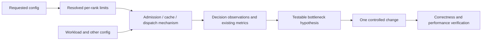

# Configuration observability graph

Use this graph to connect a tuning hypothesis to an observable decision before spending GPU time on a full benchmark. It describes SGLang at base `f91b81b82ac7701b16fff92f9e2a24e840475b37` plus the instrumentation in this branch. It is a **prioritized causal audit**, not a claim that every serving option is covered or that a log uniquely identifies the best configuration.

- `graph.json`: typed config, mechanism, metric and decision-log nodes, with source anchors, conditions, confounders, proposed experiments and remaining gaps.
- `inventory.json`: all 537 declarative `A[...]` fields found in the checked-out argument definitions. 73 have causal mappings; the rest explicitly say `not_causally_audited`. CLI spellings here are candidates, not a replacement for the parser; aliases, `no_cli`, model defaults and launcher overrides matter. Environment variables and external launcher/router knobs are not exhaustively inventoried.
- `schema.json`: versioned JSON Schema for the graph.
- `tools.py`: dependency-free source/edge/event-contract/inventory validator and config lookup. Run with Python 3.10+ from any directory.

```bash
python python/sglang/srt/observability/config_graph/tools.py --check
python python/sglang/srt/observability/config_graph/tools.py --config chunked-prefill-size
python python/sglang/srt/observability/config_graph/tools.py --config num-reserved-decode-tokens
```

Lookup includes interacting mechanisms and other controls on the same mechanism. An unknown lookup is **unreviewed**, not proof the option has no performance effect. Source anchors are drift checks, not proof a relationship is semantically unchanged after a rebase.

## Read the graph in this order



An option controls a mechanism, but multiple options and workload features can affect the same mechanism. Edges mean `controls_or_constrains`, `observed_by`, `indirectly_observed_by` or `interacts_with`. Mechanism `behavior` is a code finding; `hypothesis` predicts an outcome that still needs an experiment. `remaining_gap` says what the available observations cannot establish.

For example, `decode.kv_budget` proves that a preallocation capacity check failed. It does **not** prove increasing memory fraction is the right fix: graph buffers, active-decode reservations, locked prefixes, shared-pool geometry or another role's arrival pattern may be involved.

## Enable live observations

Add to the existing, validated server command on both P and D:

```text
--enable-metrics
--enable-metrics-for-all-schedulers
--tuning-observation-interval 10
```

The new interval defaults to **0 (disabled)**. It produces INFO logs independently of Prometheus enablement. Use INFO logging to retain them. Prometheus collection remains in the existing metrics system; the new decision counters are structured logs, not additional Prometheus series.

Optionally enable the existing device timer with `SGLANG_ENABLE_METRICS_DEVICE_TIMER=1` for forward timing and sampled scheduler/forward overlap. Measure timer overhead separately from the new instrumentation. `--enable-forward-pass-metrics` exposes the existing IPC feed to an external consumer; it is not automatically a Prometheus scrape.

Three new record prefixes:

| Record | Meaning |
| --- | --- |
| `tuning_scheduler_config` | Scheduler-resolved chunk, prefill, running-request, token-pool and page limits after initialization. |
| `tuning_runtime` | Constructed attention backend and graph-runner classes observed at first dispatch (and when class selection changes), separately for target and draft. This is a construction receipt, not a kernel profile. |
| `tuning_observation` | Aggregated decision/check counts and CPU numeric summaries for a process-local window. Includes host, PID, TP/PP/DP rank identity, role, Unix emission time and monotonic window boundaries. |

`values` contain `count`, `sum`, `min`, `max`, `last` per numeric field. `sum/count` gives an observation-weighted mean, **not a time-weighted utilization**. Windows flush on the next observed event after the interval. They are not a heartbeat; idle or stuck processes may emit nothing. Normal interpreter exit attempts a final flush, but termination or multiprocessing exit can lose the last partial window. Keep process health and existing queue metrics alongside the logs.

No request IDs, prompts, token sequences, addresses or tensor values are logged. The recorder has a fixed event/field vocabulary. Hooks use CPU metadata and add no CUDA synchronization, collective or GPU readback. State has one writer: the normal scheduler/forward-submission thread. Concurrent forward threads/PDMux and other specialized serving paths require separate validation before use. Logging itself may block on its sink at flush time; a longer interval reduces frequency, not that possibility.

## Interpret each observation correctly

| Family | Unit / population | Meaning and limits |
| --- | --- | --- |
| `prefill.decode_interval` | Scheduling gate encounters | Explicit interval defers prefill before admission checks; queue/continuing-chunk fields distinguish idle from pending-work encounters. Not blocked wall time or completed decode steps. |
| `prefill.request_slots`, `request_limit` | Gate encounters | Physical/logical request admission versus explicit per-prefill count cap. Same queued request may encounter the gate many times. A preemption attempt can still follow a slot observation. |
| `prefill.input_budget`, `chunk_budget`, `replay_budget` | Budget-check encounters | Compute budget exhausted. Replay consumes chunk space; this is independent of free KV tokens. Budget checks also run after admitting a request, so these are not necessarily rejected candidates. |
| `prefill.full_capacity`, `swa_capacity`, `shared_capacity` | Allocator checks | Requested reservation did not fit that budget model. `memory_budget` is a higher-level wrapper observation and can accompany one of these: **do not sum them as separate failures**. Shared-pool failure cannot be assigned to one physical pool from scalar token counts alone. |
| `prefill.swa_chunk_cap` | Chunk reductions | Memory constraints reduced a chunk; admission may still succeed. |
| `prefill.admitted` | Budget charges, including continuing chunks | Actual extend rows, replay rows and output reservation charged by `_update_prefill_budget`. Not unique requests, completed forwards, or physically allocated output tokens. |
| `prefill.prefetch_pending`, `staging_pending` | Candidate scans | Cache movement prevented selecting that candidate on this pass. Not transfer time. |
| `decode.handshake_pending` | Request polls | Common bootstrapping state, which can include discovery and deferred readiness; it does not isolate prefill-complete wait. |
| `decode.*_slots`, `mamba_capacity`, `hisparse_capacity`, `host_capacity` | Admission gate encounters | That gate stopped this scan. Earlier gates hide later constraints. |
| `decode.kv_budget` | Failed device preallocation checks | CPU FULL/SWA required versus budget values. Shared physical feasibility can still fail when individual token budgets appear sufficient. |
| `decode.preallocated` | Successful device allocations | Destination space allocated, before metadata publication. Not proof the transfer started or finished. Direct host allocations/resumed requests are outside this event. |
| `graph.prefill.*` | Eligibility-check failures | First failing predicate in that check. Schedule-time voting and forward-time checks can both occur, and `local_ineligible` can accompany a more specific reason. These counts are **not fallback percentages**. |
| `forward.target.*`, `forward.draft.*` | ModelRunner dispatches | Successful return from the selected execution path (GPU work may still be asynchronous). Eager includes idle/mixed/other modes; decode runner may handle speculative verify. Not a count of completed GPU kernels, and not proof every layer was graphed. |

The graph nodes include every event in `tuning.py`. Existing `cuda_graph_passes_total` is still the preferred graph-use counter; inspect its labels/producer when comparing with the new broader dispatch counts. Local context-limit failures currently combine a missing context bound with an exceeded bound; inspect the workload/runner configuration before increasing coverage.

## Existing telemetry to reuse

Read metric definitions in `metrics_collector.py` and their producers in `scheduler_components/metrics_reporter.py`. A defined metric with a zero value can mean its producer is inactive. Cache, EPLB and storage collectors have their own gates. Decode statistics often update at `--decode-log-interval`; prefill has different reporting cadence. Request latency histograms and transfer histograms generally describe completed stages, so they can miss a currently stuck request.

Useful live series (preserve instance/rank labels rather than blindly summing replicated TP work):

- Supply/queues: `num_queue_reqs`, P bootstrap/inflight counts, D prealloc/transfer counts, HTTP active requests.
- Capacity: FULL/SWA/Mamba available, evictable and used tokens, actual maximum capacities, weight/KV/graph memory.
- Work: rates of `prefill_effective_tokens_total` by input/device-hit/host-hit/storage-hit mode; accepted speculative length; rates of `realtime_tokens_total`.
- Time: rates of `scheduler_stage_seconds_total`, `scheduler_process_cpu_seconds_total`, `forward_execution_seconds_total`; transfer and loadback latency histograms.
- Cooperation: DP token imbalance and sync wait; EPLB balance statistics when enabled.

Scheduler process CPU can exceed one CPU-second per wall-second because it includes threads. Sampled `forward_overlap=full/partial/none` is not exact exposed time; `none` can also mean timing unavailable. Logical token throughput includes reuse and must not be confused with output-token throughput or GPU FLOPs.

## First diagnosis examples

| Observed together | Hypothesis to test | Next controlled change / disproof |
| --- | --- | --- |
| Queued P work, input/chunk budget encounters, free KV, request caps not binding | Prefill compute budget is limiting batch formation | Raise only the effective per-rank budget; check workspace/replay limits and whether P service rate rises without worsening tails. |
| D prealloc grows; `decode.request_slots` frequent; KV still free | Incoming request rows limit transfer admission | Test extra slots at fixed KV capacity. If KV gates immediately replace row gates, more slots will not sustain a gain. |
| D prealloc grows; `decode.kv_budget`; high pending reservation usage | Destination memory held before requests can decode | Compare early vs deferred readiness with identical workload/caps. Low-pressure latency can worsen even if high-pressure throughput improves. |
| Good cache hits, many admitted replay rows, long CPU stages | Cached work still incurs replay/submission overhead | Separate replay-tail and full-prefill graph paths; inspect actual dispatch before interpreting an enabled flag. |
| Mostly eager forwards plus context-coverage failures | Graph captures do not cover observed context | Increase coverage in a controlled trial and account for lost KV capacity. DP-vote failures instead require examining peer-rank eligibility. |
| Idle GPU capacity, few scheduler arrivals, busy frontend | Request processing starves serving | Measure offered→HTTP→scheduler arrival; then test frontend changes. Increasing GPU batch caps cannot fix missing arrivals. |

## Outstanding instrumentation design

These are explicit gaps, not completed features:

1. **External MoE variant provenance:** record the library-resolved kernel variant per capture/replay key and a bounded workload-shape summary. Inspect FlashInfer/DeepGEMM APIs first. SGLang wrapper choice or a Python kernel-call counter cannot prove Generic versus GenPhase during CUDA graph replay. Use actual kernel profiles until this exists.
2. **PD stage age / exposed waits:** add per-stage oldest age and transition residence histograms using existing lifecycle timestamps, covering cancel, retry, recompute and host receive. Separate discovery, readiness, capacity, wire completion and delayed polling. Do not add a per-request metric label or scan all queues every hot-loop iteration.
3. **CPU/cache overlap:** attach existing completion events to transfers and bounded replay-tail submissions; accumulate CPU/device/exposed time without synchronization. First validate existing timer event ownership and overlap semantics.
4. **Host capacity and placement receipt:** record actual affinity, huge-page backing and per-worker Engram/cache budgets at initialization. Host DRAM is shared beyond one scheduler; do not sum duplicated/shared allocations as independent bytes.
5. **Router and kernel imbalance:** connect the deployed router's decision telemetry and a bounded per-layer worst-rank MoE/rebalance summary. These belong to their respective owners; a generic scheduler queue length cannot substitute.

## Phase 3 validation and scarce-GPU workflow

Local validation covers recorder contracts and selected production branches using fake resources; it **does not establish CUDA graph safety, server startup, native correctness or serving overhead**.

1. Pin source/image/library/model/config revisions. Save requested command plus resolved startup records. Hold P:D ratio, concurrency, acceptance methodology, clocks/fabric and cache warmup fixed. Use existing validated recipes, not a newly invented baseline.
2. On any suitable GPU first, run a small AGG and P/D smoke with instrumentation off/on. Include TP and attention-DP, real cancellation/retraction, low slot/capacity limits, graph-eligible and ineligible inputs. Verify unchanged native outputs/accuracy and no new collectives/synchronization in a profile.
3. Provoke one known limit at a time: a tiny prefill token budget, a request-row cap, a FULL/SWA cap and an out-of-coverage graph context. Confirm the intended signal fires and clears when the limit changes. Check both roles/ranks and that records remain bounded.
4. Measure disabled and enabled overhead with a stable repeated workload and the same existing metric/timer flags. Suggested acceptance: no repeatable >1% throughput or step-time regression at a 10-second log interval; if noise exceeds that, gather repeats rather than declaring success. Count log bytes and check sink stalls.
5. For AgentX tuning, characterize the full canonical replay first while following the graph throughout. Retain early pressure bursts and late cache/trajectory regimes. Select one intervention from the completed evidence and run its full comparison; do not assume an early steady window represents the hour.
6. Calibrate shorter diagnostic sections only after complete runs establish the regimes and ranking they preserve or miss. Qualification still uses canonical full-duration scoring, workload rules and acceptance methodology. Check correctness, output throughput, logical throughput, interactivity and TTFT/ITL. Never promote an unqualified microbenchmark or an altered acceptance methodology to a serving gain.
7. If observations cannot distinguish alternatives, record the missing causal edge and add/validate a signal before starting another wide sweep. Preserve negative results and unresolved cases.

## Phase 3 explanation companion

See `explanation_model.json` for observation -> competing diagnoses -> discriminating checks -> config intervention rules. Evidence status is explicit; source-backed hypotheses are not measured throughput wins. The GB200 starting recipe uses an explicit prefill/decode interval, now mapped separately from the prefill delayer and token-budget gates.

Existing textual startup receipts use `kind: log_line`; structured TuningRecorder events use `decision_log` and validate against EVENTS. Both require a checked producer source anchor. Host-table backing receipts are existing logs, not new runtime instrumentation. Graph-use metric modes separate prefill from decode; aggregate eager event counts still mix modes.

Optional OpenAI cache accounting is modeled separately as a `response_field`, not a Prometheus series or TuningRecorder event. `--enable-cache-report` exposes existing cached-token metadata; missing usage detail does not mean zero reuse. Input-length strata alone cannot isolate prefill cost. Validate client coverage/accounting and reporting overhead before relying on this field, and preserve canonical logical-token scoring.

Phase3 workload policy: establish a full canonical AgentX replay while following graph evidence throughout. The initial900-second cadence comparison demonstrates a prefix tradeoff, not full-workload optimization. Treat shorter sections as a later calibration problem against complete runs, retaining late regimes and counterexamples.

Cache interpretation: device eviction can be normal migration to host; `hicache_dropped_tokens_total` measures device KV discarded without backup, not ordinary L2 host eviction. ActiveKVusage excludes evictablecachedslots. With DPattention, cache TP labels are attention-mesh coordinates; do not join blindly to scheduler globalTP labels. Preserve token versus physical-byte semantics and avoid adding overlapping eviction/backup durations.

DP telemetry requires `SGLANG_ENABLE_METRICS_DP_ATTENTION=1`; exported zero histograms with disabled producers are not evidence of balance or no wait. The max/mean ratio is reported once by attention DP0/TP0/CP0. Scheduler stage counters are exclusive wall time, not process CPU time. Their overlap labels sample endpoints, and `none` also covers unavailable device timing; they never directly measure exposed GPU idle seconds. See companion rule `producer-enablement-before-zero`.

Canonical warmup is load-dependent: AgentX concurrency counts trajectory lanes, and the preset sends mandatory snapshot primers plus ten additional warmup requests per lane. A fresh server at each point does not imply identical cache state at profiling start when concurrency changes. Record warmup counts/duration and initial cache state, keep the preset unchanged, and treat the measured difference as an end-to-end load-point effect rather than isolated batch scaling.

Benchmark lifecycle also matters: require complete canonical exports and validation after traffic and drain. In the GB200 campaign, a soft allocation headroom guard terminated final processing while the client waited for `server_metrics`; the send window had completed with zero request errors. The missing aggregate prevents qualification. Keep raw artifacts durable from launch and record external guard changes separately from server tuning.


Runtime identity includes the **constructed backend**, not just the source and image hashes. In the GB200 campaign, earlier full runs selected Python TreeCore after compiler discovery failed. A new deployment had a working compiler but no Rust binding in its source overlay; inherited build mode `never` then prevented loading the selected implementation. Explicit Python selection restored the backend actually used by the baseline, verified through every rank's existing `Tree Core:` startup receipt. See `mechanism.tree_core_selection` and companion rule `resolved-cache-backend`. Record requested backend, effective build mode, toolchain outcome and binding origin before comparing configurations. Treat a different native implementation as a separate experiment.


Environment evidence has a measurement boundary: `/proc/PID/environ` may omit values after process-title updates even when Python `os.getenv()` still returns them. A CPU-only reproduction demonstrated this with the serving image's `setproctitle`. Treat a missing procfs entry as unknown; combine explicit launch controls, source defaults, constructed-backend receipts, producer count coverage and, when needed, bounded in-process resolved-value receipts. Do not claim a producer is disabled solely from a procfs omission.

Prefill budgets are ordered checks, not independent cause counters. When input and chunk limits deplete together, `prefill.input_budget` masks `prefill.chunk_budget`. Compare both residuals in `prefill.admitted`; a changed event name alone does not demonstrate increased capacity. In the normal chunked path, shape selection fits chunk/KV limits, so `max_prefill_tokens` is not a universal hard ceiling on an individual forward. MegaMoE validates the aligned effective per-rank chunk against its token-cap environment setting, which also sizes symmetric buffers. A larger chunk may require a coupled workspace change; record that dependency and physical memory headroom before testing.

Scheduling order is mapped separately from capacity and cadence. `schedule_policy` influences which requests receive prefill work; shortest-prefill-first uses queue age only after estimated uncached work ties and can reserve continuing-chunk budget for shorter queued work. Existing `queue_time_seconds` observes one scheduler wait before the first forward, on admission. It excludes still-waiting requests: more long-wait observations can mean old backlog is finally clearing. Preserve that censoring and producer scope when comparing with tokenizer/client TTFT. See companion rule `prefill-ordering-and-aged-queues`.


## Optional allocator endpoint snapshot

For a later validated deployment, set `SGLANG_TUNING_CUDA_ALLOCATOR_STATS=1` with a positive tuning observation interval. It is disabled by default and has not been deployed in the Phase 3 R6 experiment. CPU contract tests pass; actual GPU integration and disabled/enabled overhead remain to be checked.

Each nonempty `tuning_observation` flush then adds `allocator_snapshot`. The native PyTorch backend reports current allocated, reserved, active and inactive-split bytes, plus cumulative allocation-retry and OOM counters. These are endpoint values, not window means or peaks. No sample is taken per scheduling event, while disabled, or for an empty flush. The sampler does not request CUDA initialization, synchronization, cache clearing or peak-stat resets.

`not_initialized`, `unsupported_backend` and `error` statuses carry no numerical values. `partial` omits missing/invalid fields; absence is not zero. The checked container's PyTorch documents that some cudaMallocAsync statistics always return zero, so that backend is deliberately unsupported. Preserve process/rank identity before taking counter deltas. Native allocator scope may exclude private/custom pools and external library allocations; reserved minus allocated is not a promise of reclaimable memory. Pair this observation with existing capacity records and separately validated buffer-creation receipts.


## Optional MegaMoE buffer provenance

`SGLANG_TUNING_MOE_BUFFER_STATS=1` enables `tuning_moe_buffer` after each process-local SGLang buffer-cache miss, independently of the observation interval. It is disabled by default and has not been deployed in R6. CPU tests check cache-hit silence, unchanged buffer identity and metadata failure handling; actual GPU/library behavior remains unvalidated.

The receipt reads existing CPU metadata: requested and aligned token caps, process-group size, expert/top-k/hidden/intermediate/shared-expert geometry, SMS, bounded MMA/activation kinds and exposed tensor bytes. It adds no sizing query, tensor read, collective or synchronization to the existing allocation path. Cache misses do not prove fresh physical allocation in the library/allocator. Process-group identity and addresses are omitted; identical geometry is not sufficient to deduplicate receipts. The reported tensor size excludes other allocations and transient peaks. Missing metadata is `unavailable`, not zero. Pair this provenance with allocator snapshots and physical-memory observations after GPU validation.
